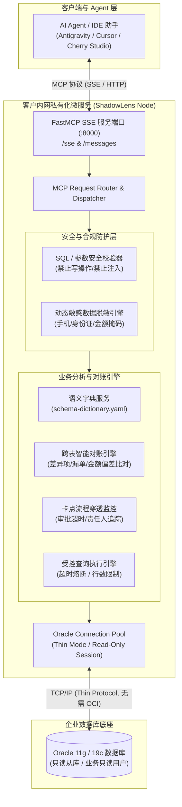
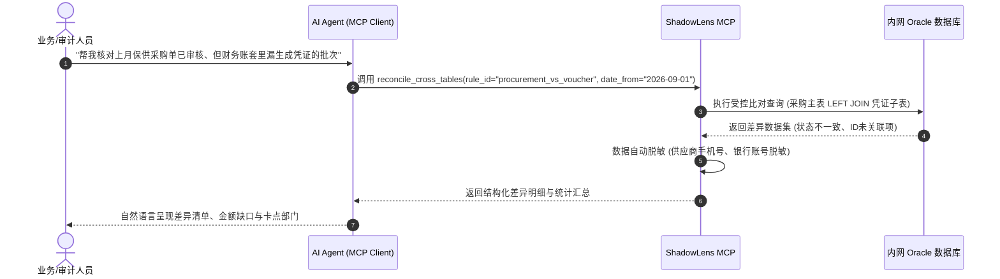

# ShadowLens (影子透镜)
### —— 面向企业复杂老旧系统 (Oracle/OA/ERP) 的受控只读 MCP 穿透与对账智能体

> **版本**：v1.0.0  
> **状态**：已固化（Validated & Technical Prototype Built）  
> **核心架构**：Python 3.13 + FastMCP (SSE / Stdio) + OracleDB (Pure Thin Mode)  
> **部署形态**：客户局域网/内网私有化微服务 (Docker / Systemd / Bare-Metal)

---

## 1. Problem Statement (问题陈述)

> **How Might We** 在**完全不侵入老系统生产代码、不依赖老系统厂商排期提供接口、零写操作风险**的前提下，将企业 Oracle 底座系统（致远协同 OA、用友 ERP、若依/定制业务中台等）的深层数据与流转状态，快速活化为现代 AI Agent 可安全调用的只读 MCP 业务代理，实现秒级跨库穿透核验与智能对账？

---

## 2. 核心设计原则与架构权衡 (Design Philosophy)

1. **绝对只读安全（Physical & Logical Read-Only）**
   - **连接层**：推荐只读从库或仅授予 `SELECT` 权限的 Oracle 数据库用户；
   - **会话层**：连接建立后执行 `ALTER SESSION SET TRANSACTION READ ONLY` 锁定会话级别只读；
   - **应用层**：SQL 校验引擎白名单拦截，严禁任何 `INSERT/UPDATE/DELETE/DROP/ALTER/TRUNCATE` 或存储过程执行；
   - **安全熔断**：单次查询默认 5 秒超时强制终止，结果集默认强制分页截断（最大 200~500 行），防止恶意/错误的大表全表扫描打垮数据库。

2. **纯 Python Thin 模式，免装 Oracle Instant Client**
   - 传统企业部署 Python 连接 Oracle 时，最大的痛点是安装配置 `oracle-instantclient-basic`、设置 `LD_LIBRARY_PATH` / `OCI` 动态库，在客户纯内网无网环境极易踩坑。
   - ShadowLens 采用 `python-oracledb` 纯 Python Thin Mode 协议栈，直接基于 TCP/IP Socket 连接 Oracle 11gR2 / 12c / 18c / 19c / 21c / 23c，无需任何 C 依赖，零依赖打包单 Docker 镜像。

3. **外挂语义字典（Semantic Overlay），告别幻觉**
   - 不依赖大模型瞎猜老系统的 `field0001` 或 `vdef1`。
   - 通过外挂 `schema-dictionary.yaml` 补充中文字段名、业务枚举（如 `0: 草稿, 1: 审批中, 2: 已生效, 3: 已作废`）和关联链路。
   - AI 先通过 `get_table_dictionary` 理解领域语义，再精准发起受控参数化查询。

4. **隐私与涉密动态脱敏（Automatic Masking）**
   - 适配政企合规与涉密安全要求：身份证号、手机号、银行卡号、金额等级、密码哈希自动进行掩码处理（如 `110101********1234`、`138****0000`）。

---

## 3. 核心 MCP 工具原语 (Tools Exposed)

| MCP Tool 原语 | 作用与业务场景 |
| :--- | :--- |
| `get_table_dictionary` | 检索指定业务模块或表名的数据字典、字段中文定义、业务枚举与关联关系 |
| `query_audited_view` | 在受控白名单表/视图中按条件查询数据（带自动脱敏、分页截断与超时熔断） |
| `reconcile_cross_tables` | 执行配置化跨表双向对账（如：采购入库单 vs 财务应付凭证差异核对） |
| `fetch_stuck_workflows` | 盘点协同 OA / 业务审批流中停留超过指定时长（如 > 48 小时）的卡点单据与当前责任人 |
| `test_db_connection` | 检查内网 Oracle 数据库连通性、当前模式 (Thin Mode) 与延迟 |

---

## 4. 架构拓扑 (Architecture Diagram)

---

## 5. 跨表对账业务模型示例 (Reconciliation Model)

在政企/协同系统中，典型的“单据生成但凭证未入”或“采购单已审但未发货”往往是审计稽核的重点：

---

## 6. MVP 实施范围 (MVP Scope)

- **核心代码组件**：
  - `src/db/oracle_pool.py`: 纯 Thin Mode 连接池管理，只读会话保护，Dry-run 模拟模式；
  - `src/security/sql_validator.py`: 严格 SQL 语法分析，彻底杜绝 DML/DDL；
  - `src/security/data_masker.py`: 正则匹配敏感信息脱敏；
  - `src/services/`: 字典管理、受控查询、跨表对账与超时卡点扫描；
  - `src/server.py`: FastMCP 驱动，提供 stdio 与 SSE 两种协议运行模式；
  - `Dockerfile` / `docker-compose.yml`: 一键容器化部署；
  - `tests/test_shadowlens.py`: 完备单元测试。

---

## 7. 坚决不做清单 (Not Doing & Boundaries)

1. **坚决不做任何数据回写或自动修单**：不写老库是安全生命线，系统只定位问题、输出差异，不擅自更改业务记录；
2. **坚决不做开放式任意 Text-to-SQL 直连执行**：杜绝大模型随机生成 `DELETE` 或全表锁死；必须走白名单表与参数化查询；
3. **坚决不引入庞大前端 Web 控制台**：保持微服务极简纯粹，纯配置驱动（YAML），通过标准 MCP 协议与各类 Agent 客户端无缝对接。
